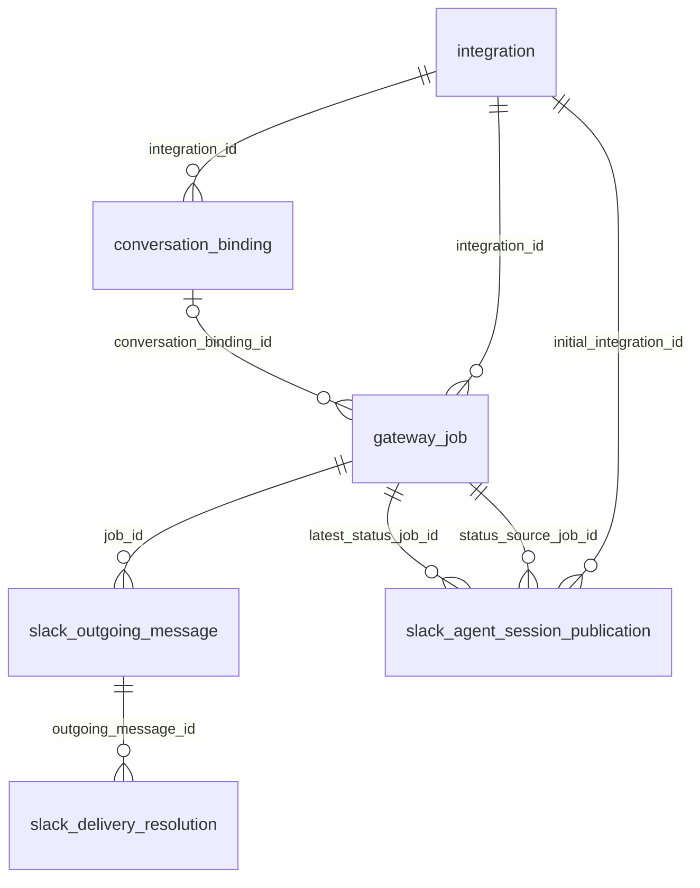

# Storage schema

The gateway has six business tables shared by SQLite and MySQL. One request
represents one accepted Slack prompt, including local execution, backend
observation and Slack progress. One binding maps an integration's Slack thread to
its backend conversation. Neither a request nor a progress publication replaces
that conversation mapping.

The authoritative definitions are `migrations/sqlite/001_initial.sql` and
`script/mysql/schema_versioned.ddl`. Generated Datly readers/writers use the same
physical names on both engines. Version metadata is separate from these six
tables. Installation uses a fresh development baseline; existing incompatible
prerelease schemas are rejected rather than migrated or reset automatically.

## Relationships



All eight foreign keys refer to a single numeric parent ID. A request may not yet
have a binding, and can also finish locally without creating one. Slack addresses
on requests remain available before binding creation and during local rejection.
The workflow checks assignment, thread and author agreement across records;
foreign keys establish parent existence. There are no automatic delete cascades.

## Identifiers

| Column | Meaning |
|---|---|
| `id` | Numeric identity of a row in its own table |
| `integration_id` | A recorded execution assignment, including its historical identity |
| `gateway_request_id` | Stable 128-bit random value encoded as 32 hex characters; unique in `gateway_job` |
| `slack_event_id` | Slack event identity; globally unique in `gateway_job` for deduplication |
| `slack_prompt_message_id` | The user's particular prompt message |
| `slack_thread_root_message_id` | The root message of the Slack thread |
| `slack_progress_message_id` | The gateway's editable progress message, if one exists |
| `slack_message_id` | One outgoing Slack message, including an answer part or notice |
| `backend_conversation_id` | Backend conversation identity; not a local foreign key |

Slack message identifiers remain opaque strings even though Slack represents them
using timestamp-like values. They are not converted to SQL dates. A follow-up has
its own prompt ID but shares the root ID with earlier prompts in that thread.

`gateway_request_id` is not a formatted UUID. Its database uniqueness constraint
is independent of the numeric primary key. The Agently adapter uses this value
for AG-UI `runId`, user message ID and extension `requestId`. Native backend turn
identity remains a different SDK concept; database renames do not change the wire
protocol. `backend_submission_started_at` marks a started attempt before network
submission; it is not a receipt from the backend and does not authorize a retry.

## Naming and capacity contracts

Physical table names are singular. Their Go entities use the same roles:
`Integration`, `ConversationBinding`, `GatewayJob`, `SlackOutgoingMessage`,
`SlackDeliveryResolution` and `SlackAgentSessionPublication`. Operator metadata
uses the corresponding `...Metadata` types. JSON collections stay plural:
`integrations`, `gateway_jobs`, `conversation_bindings`, `slack_outgoing_messages`
and `slack_agent_session_publications`. State-count keys use the physical table
name, such as `gateway_job.gateway_execution_state`.

MySQL stores bounded external IDs, Slack message/thread IDs and
`gateway_request_id` in `VARCHAR(255)`. Fixed state, mode, outcome, kind,
format, backend-type and resolution-action values have `VARCHAR(128)` capacity.
Reason codes retain their existing `VARCHAR(255)` capacity; open-ended backend
agent/conversation IDs and endpoints remain `TEXT`. The current random gateway
request ID remains 32 hexadecimal characters;
the wider column is capacity for future compatible producers, not a new generator
or wire format. The integration's configured `name` remains `VARCHAR(128)`.
Long bodies retain their existing `TEXT`, `MEDIUMTEXT` or `LONGTEXT` types.
SQLite retains native `TEXT` storage and its existing state checks.

The largest declared MySQL key is `gateway_job_thread`: its two `VARCHAR(255)`
columns, one `VARCHAR(128)` column and two `BIGINT` columns use at most 2,568
bytes in `utf8mb4`, leaving 504 bytes under the 3,072-byte InnoDB limit on the verified 16 KiB setup.
No prefix indexes or hash columns are needed. Other indexes retain their full
columns and order. The table definitions use the server's default row format;
they do not declare `ROW_FORMAT`.

## Tables and column groups

### `integration`

One row records one assignment of a configured logical name. Changing the
execution assignment allocates another numeric ID. `name` is unique in the active
configuration, not across historical database rows. `active` means present in
configuration, not that Slack or the backend is healthy.

| Group | Columns |
|---|---|
| Identity and configuration | `id`, `name`, `active` |
| Slack installation | `slack_app_id`, `slack_workspace_id` |
| Backend assignment | `backend_type`, `backend_endpoint`, `backend_agent_id`, `backend_principal_id` |
| Row dates | `created_at`, `updated_at` |

Credentials are not persisted in this table. See [integration lifecycle](integrations.md).

### `conversation_binding`

A binding is unique by `(integration_id, slack_channel_id,
slack_thread_root_message_id)`. Channel threads and direct-message threads use the
same relationship; the request's `slack_conversation_type` records their surface.

| Group | Columns |
|---|---|
| Identity and parent | `id`, `integration_id` |
| Slack thread | `slack_channel_id`, `slack_thread_root_message_id` |
| Backend identity and context | `backend_conversation_id`, `backend_principal_id`, `backend_protocol_messages`, `backend_protocol_state` |
| Gateway access and lifecycle | `gateway_access_mode`, `gateway_binding_owner_id`, `gateway_binding_state` |
| Row and lifecycle dates | `created_at`, `updated_at`, `last_activity_at`, `closed_at` |

`gateway_binding_state` describes the gateway's local binding lifecycle, not
remote backend cancellation. Principal and owner retain separate contracts even
when they have equal values in shared-principal mode. Protocol messages/state are
opaque backend data; the gateway does not rename keys inside those payloads.

### `gateway_job`

Each `gateway_job` is one durable prompt-processing job. Execution and publication
have independent states, reasons, counters and update dates in that same row;
their shared identity does not require a second status table.

| Group | Columns |
|---|---|
| Identity and relationships | `id`, `gateway_request_id`, `integration_id`, `conversation_binding_id` |
| Slack source | `slack_event_id`, `slack_channel_id`, `slack_conversation_type`, `slack_thread_root_message_id`, `slack_prompt_message_id`, `slack_prompt_author_id` |
| Prompt | `prompt_text`, `prompt_has_attachments` |
| Gateway execution | `gateway_execution_state`, `gateway_execution_reason`, `gateway_execution_outcome`, `gateway_execution_result_text`, `gateway_execution_claim_count` |
| Backend submission and polling | `backend_submission_started_at`, `backend_next_poll_at`, `backend_poll_attempts`, `backend_poll_ready` |
| Backend observation | `backend_observed_state`, `backend_observed_at`, `backend_observation_uncertain` |
| Slack progress content and target | `slack_progress_mode`, `slack_progress_message_id`, `slack_progress_phase` |
| Slack progress publication | `slack_progress_state`, `slack_progress_reason`, `slack_progress_revision`, `slack_progress_sent_revision`, `slack_progress_attempts` |
| Slack progress dates | `slack_progress_next_attempt_at`, `slack_progress_refresh_at`, `slack_progress_rate_limited_until`, `slack_progress_first_sent_at`, `slack_progress_last_sent_at` |
| Row, execution and cleanup dates | `created_at`, `gateway_execution_updated_at`, `gateway_status_updated_at`, `gateway_execution_finished_at`, `content_purged_at` |

`gateway_execution_outcome` includes failures established locally before any
backend submission. `gateway_execution_result_text` is the selected result before
Slack presentation; individual outgoing messages contain the presented parts.
`gateway_execution_claim_count` counts work claims, including observation work,
not the number of prompt submissions.

A completed execution can still have pending or uncertain delivery. It does not
mean that every outgoing message and status update has finished. An absent
submission date, observation date or first-publication date is SQL `NULL`.

### `slack_outgoing_message`

| Group | Columns |
|---|---|
| Identity and parent | `id`, `job_id` |
| Message | `slack_message_index`, `slack_message_kind`, `slack_message_text`, `slack_message_format`, `slack_message_id` |
| Delivery | `slack_delivery_state`, `slack_delivery_attempts`, `slack_delivery_next_attempt_at` |
| Row dates | `created_at`, `updated_at` |

`slack_message_index` starts at zero within a request; `(job_id,
slack_message_index)` is unique. Message kinds distinguish answer parts from
integration-closure notices. A Slack message ID confirms a known send or an
operator's explicit delivered assertion; it is separate from the prompt ID.

### `slack_delivery_resolution`

| Group | Columns |
|---|---|
| Identity and parent | `id`, `outgoing_message_id` |
| Resolution | `resolution_action`, `duplicate_delivery_risk_accepted`, `slack_message_id` |
| Audit date | `created_at` |

This is an append-only audit of operator decisions for uncertain delivery. A
provided Slack ID is an operator assertion, not a separately verified Slack API
receipt. There is no `updated_at` because existing audit rows are not edited.

### `slack_agent_session_publication`

One native Slack session concerns the physical app/workspace/channel/thread and
may span assignment changes. Its `initial_integration_id` remains the original
anchor. `latest_status_job_id` identifies the latest native/hybrid request
that created or refreshed the publication. `status_source_job_id` supplies
the original author/access context for a particular publication.

| Group | Columns |
|---|---|
| Identity and references | `id`, `initial_integration_id`, `latest_status_job_id`, `status_source_job_id` |
| Slack thread and initiator | `slack_channel_id`, `slack_thread_root_message_id`, `slack_initiator_user_id` |
| Native Slack status | `slack_agent_desired_status`, `slack_agent_observed_status`, `slack_session_observed_status` |
| Local publication | `slack_publication_state`, `slack_publication_reason`, `slack_publication_warning`, `slack_publication_revision`, `slack_publication_sent_revision`, `slack_publication_claimed_revision`, `slack_publication_attempts` |
| Publication dates | `slack_publication_next_attempt_at`, `slack_publication_refresh_at`, `slack_publication_rate_limited_until`, `slack_publication_first_sent_at`, `slack_publication_last_sent_at` |
| Row dates | `created_at`, `updated_at` |

Desired status, Slack's returned status for this agent, aggregate session status
and local publication state are different facts. Native `active` means readiness
for another question, not that the conversation is permanently closed. The
workflow preserves source-author authorization when ending historical progress.

## Dates and time ownership

MySQL uses `DATETIME(3)`; SQLite uses `DATETIME` through native Datly time values.
The application normalizes moments to UTC and truncates to milliseconds before
writing/comparing them. Optional moments use SQL `NULL`, not numeric zero or
zero dates. Numeric IDs, counters, revisions and measured durations are not dates.

| Date | What advances it |
|---|---|
| `created_at` | Initial row creation only |
| `updated_at` | Mutation of its owning binding, integration, outgoing message or session publication |
| `gateway_execution_updated_at` | Operations that previously updated the execution/job record |
| `gateway_status_updated_at` | Backend observation/outcome and progress publication, initialization, reconciliation and recovery |
| `gateway_execution_finished_at` | First actual transition to local `completed` or `rejected`; not `needs_review` |
| `last_activity_at` | Accepted nonduplicate prompt, local execution completion or confirmed outgoing delivery |
| `closed_at` | First local closure of the binding |
| `content_purged_at` | Future atomic removal of a request's redundant bodies and its outgoing bodies |

`gateway_execution_finished_at` is not a declaration that retention is safe.
Future cleanup must also inspect outstanding delivery/publication and unresolved
review states. Execution/status update timestamps preserve their separate
operation ownership; neither is an automatic last-change date for every column
in the merged request.

Binding activity moves forward monotonically. Polling, heartbeat, retry scheduling,
configuration reconciliation itself and body redaction do not extend conversation
activity. `content_purged_at` remains `NULL` during normal operation because no
cleanup process is implemented.

Operator JSON dates retain Unix-millisecond numbers with `_ms` suffixes; missing
moments are represented as `0`. A measured acknowledgment latency is a duration:
unknown is `null`, while a known measurement can validly be zero. See
[operator diagnostics](operations.md).

## Future retention contract

The schema prepares two distinct future operations. Neither has a configured
age limit, scheduled worker, runtime deletion API or CLI command today. A later
implementation will define the configurable retention periods and batch policy.
The database records needed facts now; no age-based deletion occurs implicitly.

### Remove redundant bodies and preserve continuation

For an eligible, settled request, future cleanup can atomically clear:

- `gateway_job.prompt_text`;
- `gateway_job.gateway_execution_result_text`;
- `slack_outgoing_message.slack_message_text` for that request;
- and then record `gateway_job.content_purged_at` in the same transaction.

Rows, identifiers, deduplication, original author/access data, states, counters,
resolution audit and binding remain. New questions in the old thread continue
through the same backend conversation. Work with pending/sending messages,
uncertain delivery or unresolved intervention must not be treated as redundant
simply because its creation or execution-completion date is old.

`backend_protocol_messages` and `backend_protocol_state` remain for both backend
kinds while continuation is preserved. Agently owns server-side history; generic
AG-UI uses the saved protocol context when constructing its next run. Protocol
context may contain the same text, so this partial cleanup removes redundant
copies rather than promising complete erasure of conversation content.

### Forget the entire old conversation

Full cleanup removes local context, mapping and deduplication history without
leaving a tombstone. A later prompt in that old Slack thread may therefore start
a new backend conversation without the former history. This does not delete the
conversation from Slack or the backend.

Deletion must consider the entire physical Slack thread across historical
assignments, not just one binding. Session publication pointers can reference
requests from earlier assignments. After verifying that all affected work and
publication are settled and reviews resolved, the dependency order is:

```text
slack_agent_session_publication
                ↓
slack_delivery_resolution
                ↓
slack_outgoing_message
                ↓
gateway_job
                ↓
conversation_binding
```

An integration can be removed only when it is no longer active in configuration
and has no remaining references. No automatic cascade or reassignment of a
publication's source author is introduced to make cleanup easier. Removing
unresolved delivery must not silently unblock a thread or change publication
ordering.

The prepared indexes support candidate scans by `(content_purged_at,
gateway_execution_finished_at, id)` and `(last_activity_at, id)`, request lookup
by binding/completion, and indexed traversal of outgoing-message and native
publication foreign keys. They support bounded future batches without indexing
every timestamp or adding a second retention-state projection.
